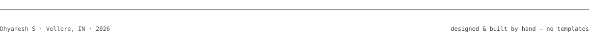

  <picture></picture>

 

  <a href="#flagship-systems">Featured Systems</a>&nbsp;&nbsp;·&nbsp;&nbsp;
  <a href="#engineering-domains">Domain Architecture</a>&nbsp;&nbsp;·&nbsp;&nbsp;
  <a href="#stack">Technical Stack</a>&nbsp;&nbsp;·&nbsp;&nbsp;
  <a href="#contact">Contact</a>

<picture></picture>

### Currently

<picture></picture>

<picture></picture>

<h3 id="flagship-systems">Top Flagship Systems</h3>

<table>
  <tr>
    <td width="50%">
      
      
Enterprise static codebase analysis, dependency graph extraction & architecture intelligence.

    </td>
    <td width="50%">
      
      
High-performance cloud storage with content-addressed deduplication and in-browser editors.

    </td>
  </tr>
  <tr>
    <td width="50%">
      
      
Hardware-accelerated web OS with window virtualization, Web Audio API & IndexedDB storage.

    </td>
    <td width="50%">
      
      
Enterprise AI technical interview simulation, compiler sandbox & real-time multiplayer coding arena.

    </td>
  </tr>
</table>

<picture></picture>

<h3 id="engineering-domains">Systems &amp; Engineering Ecosystem</h3>

<table>
  <tr>
    <th width="33%">⚡ Code Intelligence &amp; DevTools</th>
    <th width="33%">🛡️ Distributed Systems &amp; Concurrency</th>
    <th width="33%">📱 Offline-First &amp; Deep Tech</th>
  </tr>
  <tr>
    <td valign="top">
      • <a href="https://github.com/Dhyanesh2603/Codemap"><b>Codemap</b></a> <i>(Python)</i> 
      Codebase intelligence, AST drift detection and change blast-radius analysis.  
      • <a href="https://github.com/Dhyanesh2603/culprit"><b>culprit</b></a> <i>(TypeScript)</i> 
      Production incident attribution correlating errors directly to git commits.  
      • <a href="https://github.com/Dhyanesh2603/change-detector"><b>change-detector</b></a> <i>(Python)</i> 
      Automated visual regression and website change monitoring platform.  
      • <a href="https://github.com/Dhyanesh2603/ggblog"><b>ggblog</b></a> <i>(TypeScript + React)</i> 
      Modern web novel and technical reader platform with writer studio.
    </td>
    <td valign="top">
      • <a href="https://github.com/Dhyanesh2603/TheLastSeat"><b>TheLastSeat</b></a> <i>(Python)</i> 
      High-concurrency ticket engine mathematically guaranteeing zero double-bookings.  
      • <a href="https://github.com/Dhyanesh2603/campus-sensor-engine"><b>campus-sensor-engine</b></a> <i>(Python)</i> 
      GDG Staff-level IoT environmental and telemetry sensor stream processing engine.  
      • <a href="https://github.com/Dhyanesh2603/ProxyProof"><b>ProxyProof</b></a> <i>(Python + Android)</i> 
      Anti-proxy attendance system with geofenced mobile cryptographic telemetry.  
      • <a href="https://github.com/Dhyanesh2603/worklogix"><b>worklogix</b></a> <i>(Python)</i> 
      Enterprise workstation activity telemetry and automated timesheet tracker.
    </td>
    <td valign="top">
      • <a href="https://github.com/Dhyanesh2603/Idem"><b>Idem</b></a> <i>(Dart + Flutter)</i> 
      Offline-first deterministic workstation with local SQLite WAL and FIFO queue sync.  
      • <a href="https://github.com/Dhyanesh2603/Arete"><b>Arete</b></a> <i>(Dart + Flutter)</i> 
      Modular engineering productivity workspace built for technical execution.  
      • <a href="https://github.com/Dhyanesh2603/thewatercrew"><b>thewatercrew</b></a> <i>(TypeScript)</i> 
      Marine hydrodynamics and environmental remediation with VIT research labs.  
      • <a href="https://github.com/Dhyanesh2603/JustDeal"><b>JustDeal</b></a> <i>(Python + ML)</i> 
      AI real estate valuation and rental yield investment analytics engine.
    </td>
  </tr>
</table>

<picture></picture>

<h3 id="stack">Technical Stack</h3>

<picture></picture>

<picture></picture>

<h3 id="contact">Contact &amp; Connect</h3>

Open to **SDE, AI Engineering and Systems** opportunities.

  &nbsp;&nbsp;
  &nbsp;&nbsp;
  

 

<picture></picture>
